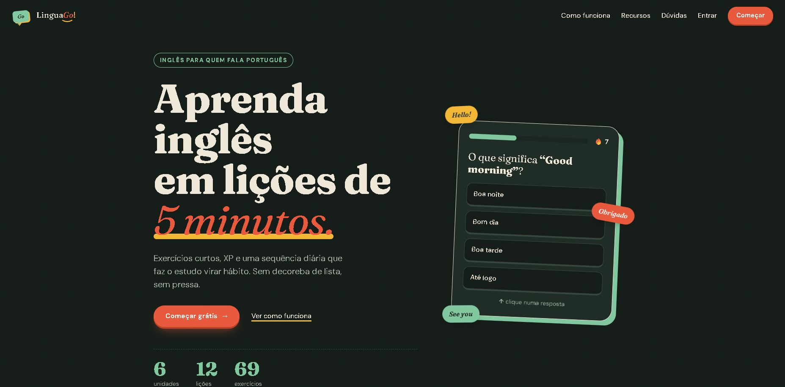
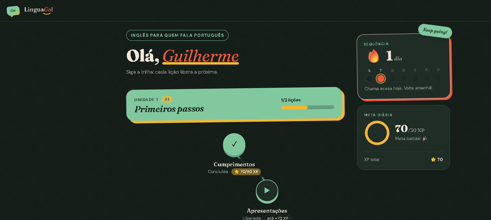
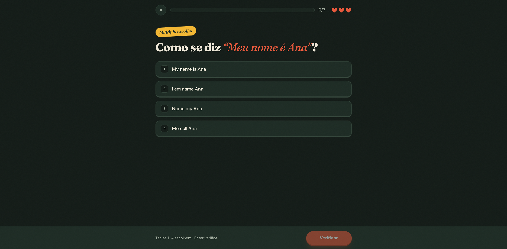
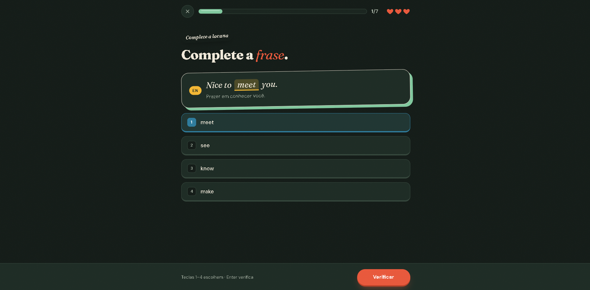

<p align="center">
  <picture>
    <source media="(prefers-color-scheme: dark)" srcset="public/logo-linguago.svg">
    
  </picture>
</p>

# LinguaGo

App web para aprender inglês em lições curtas, feito para quem fala português. A trilha vai do A1 ao C1, com XP por acerto, meta diária e sequência de dias de estudo.

**Site:** https://linguago-delta.vercel.app

## Telas

| Página inicial | Cadastro |
|---|---|
|  |  |

| Trilha de lições | Exercício de múltipla escolha | Exercício de completar a frase |
|---|---|---|
|  |  |  |

## Funcionalidades

- **Trilha:** 6 unidades e 12 lições, do A1 ao C1. Cada lição concluída libera a próxima.
- **Exercícios:** múltipla escolha, tradução, associar pares, montar a frase, completar a lacuna e escutar e escrever. São 69 no total.
- **Lição:** 3 vidas por lição, correção na hora e atalhos de teclado.
- **Teste de nivelamento:** opcional, com 10 perguntas. Libera as unidades até o nível alcançado.
- **Progresso:** 10 XP por acerto, meta diária de 30 XP e sequência de dias, com datas no fuso horário do usuário.
- **Conta:** login com e-mail e senha. O progresso fica salvo na conta, não no navegador.
- **Progresso antigo:** quem usou a versão anterior, que salvava no navegador, pode importar esse progresso para a conta uma única vez.

## Tecnologias

- React 19, Vite e React Router
- Supabase: autenticação e banco Postgres
- Vercel: hospedagem
- Oxlint: análise do código

## Segurança

- **RLS em todas as tabelas:** cada usuário só lê os próprios dados.
- **Gravação só pelo banco:** o navegador não grava direto nas tabelas de progresso. Tudo passa pelas funções `complete_lesson` e `import_local_progress`, que identificam o usuário pela sessão e calculam e limitam o XP no servidor.
- **Data da lição conferida no servidor:** `complete_lesson` só aceita o dia de hoje, com 1 dia de folga para mais ou para menos, no fuso salvo no perfil. Isso impede registrar lições em datas inventadas para inflar a sequência.
- **Teste automatizado das políticas:** `supabase/tests/rls_test.sql` confere, com dois usuários de teste e um visitante sem login, que ninguém lê dados de outra pessoa, altera o próprio XP ou grava uma data falsa.
- **Chaves:** o front-end usa só a chave pública do Supabase. O `.env` não vai para o repositório.

## Como rodar localmente

Requisitos: Node.js 20.19 ou mais recente e um projeto no [Supabase](https://supabase.com).

```bash
npm install
cp .env.example .env   # preencha com a URL e a chave publishable do seu projeto
npm run dev
```

O app abre em http://localhost:5173.

Outros comandos: `npm run build` gera a versão de produção, e `npm run lint` roda o Oxlint.

## Banco de dados

No **SQL Editor** do Supabase:

1. Rode `supabase/migrations/001_init.sql`. Ele cria as tabelas, as políticas de RLS, as funções e o gatilho que cria o perfil no cadastro.
2. Rode `supabase/migrations/002_validate_lesson_day.sql`. Ele ativa a conferência da data da lição.
3. Rode `supabase/tests/rls_test.sql`. Todos os testes devem terminar como `OK`.

Em **Authentication**, deixe o login por e-mail ativo e coloque `http://localhost:5173` em **URL Configuration**.

## Áudios das frases

As frases em inglês tocam a partir de MP3s em `public/audio/`, gerados no seu computador com o modelo de voz Kokoro. Se uma frase não tiver MP3, o app usa a voz em inglês do navegador. Depois de criar ou mudar uma lição, rode:

```bash
npm install --prefix scripts/audio   # só na primeira vez
npm run audio                        # gera só as frases novas ou alteradas
```

`npm run audio -- --dry-run` mostra o que seria gerado, e `--prune` apaga os áudios de frases que não existem mais. Não precisa de chave de API, e as dependências do script não entram no site.

## Deploy

Na Vercel, importe o repositório e cadastre `VITE_SUPABASE_URL` e `VITE_SUPABASE_PUBLISHABLE_KEY` nas variáveis de ambiente. O `vercel.json` faz todas as rotas abrirem o app. No Supabase, adicione o endereço do site em **URL Configuration**.

## Estrutura

```
src/
  pages/        telas (início, login, trilha, lição, nivelamento, perfil)
  components/   componentes reutilizáveis
  auth/         sessão e perfil do usuário
  progress/     regras de XP e sequência, e leitura do progresso no banco
  exercises/    correção dos exercícios e áudio
  data/         conteúdo do curso (lições em JSON)
  storage/      migração e backup do progresso antigo do navegador
  lib/          cliente do Supabase
supabase/
  migrations/   esquema do banco
  tests/        teste das políticas de RLS
scripts/
  audio/        script que gera os MP3s das frases
public/
  audio/        MP3s das frases e o manifest.json
docs/
  screenshots/  imagens deste README
```

## Autor

Guilherme: [github.com/GuilhermeLeitsx](https://github.com/GuilhermeLeitsx)
